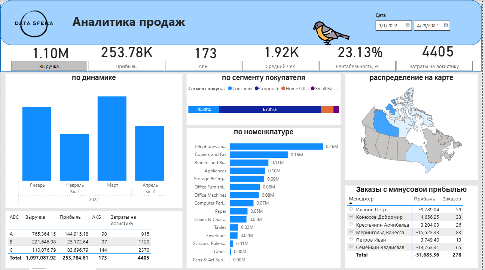

# Sales Analytics Dashboard (Power BI)

A sales dashboard for January–April 2022, built as a test assignment in a data analytics course. It gives management a one-page view of revenue, profitability, customers and problem orders.

**Tools:** Power BI Desktop, DAX, Power Query

## Data model

Star schema with a `Sales` fact table and dimension tables for order dates, managers, customers, products and delivery costs, plus a Calendar table and a field parameter for switching metrics. All relationships are single-direction.

## Key metrics

| Metric | Value |
|---|---|
| Revenue | 1.10M |
| Profit | 253.78K |
| Profitability | 23.13% |
| Active customer base | 173 |
| Average check | 1.92K |
| Logistics costs | 4,405 |

## What the dashboard shows

- **Revenue dynamics** by month
- **Customer segments:** Corporate customers bring 68% of revenue, Consumer 20%
- **Revenue by product subcategory**, led by telephones and copiers
- **Map** of sales by province
- **ABC analysis:** revenue, profit, active customers and logistics costs for groups A, B and C
- **Orders with negative profit by manager:** 278 loss-making orders with a total loss of 51.7K, used to find managers who need attention

## Files

- `DataSferaEA.pbix`: the Power BI report
- `images/`: dashboard screenshot
