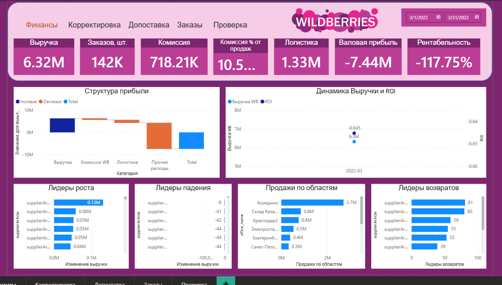

# Wildberries Finance Dashboard (Power BI)

A financial dashboard for a Wildberries seller for March 2022, built from a technical specification and a dictionary of metrics.

**Tools:** Power BI Desktop, DAX, Power Query (M)

## Technical highlights

- **Data loading without a connector:** source tables are stored in Google Sheets and loaded via the `Excel.Workbook()` function in Power Query, without the built-in Google connector or authorization
- **Import mode** for all sources
- **Data model:** WB orders, sales report, stock and supplies tables, plus reference tables for cost price, tariffs and delivery, products, metric descriptions and a Calendar table

## Report pages

**Finance** (main page):
- KPIs: revenue 6.32M, 142K orders, WB commission 718K, logistics 1.33M, gross profit and profitability
- Profit structure as a waterfall chart: revenue → WB commission → logistics → other expenses → total
- Revenue and ROI dynamics
- Growth and decline leaders by article (month-over-month revenue change)
- Sales by warehouse and return leaders

Additional pages: Adjustments, Re-supply, Orders, Checks.

## Files

- `images/`: screenshots of the report pages
