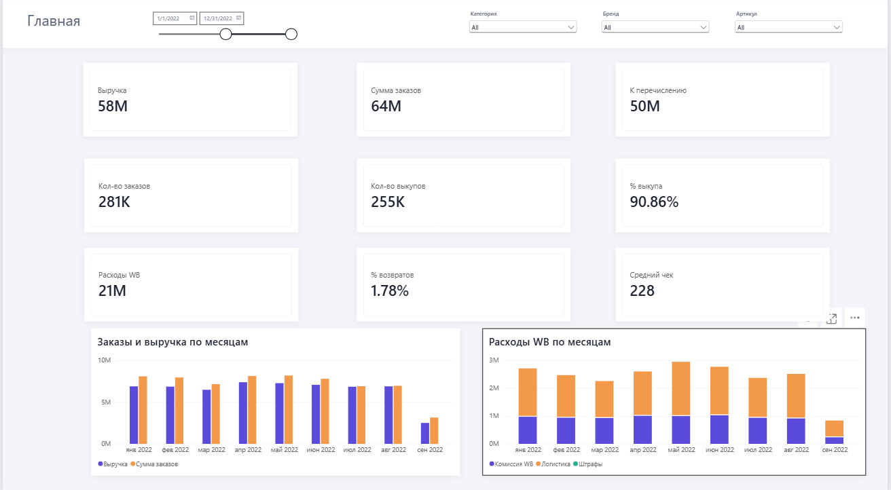
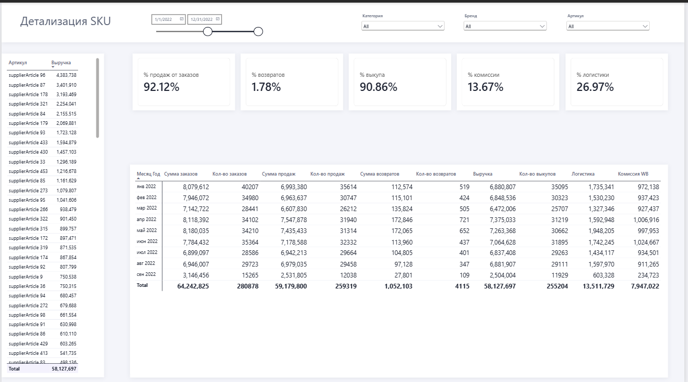
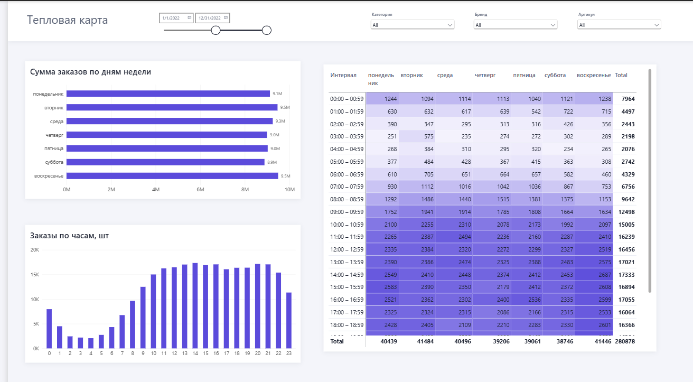
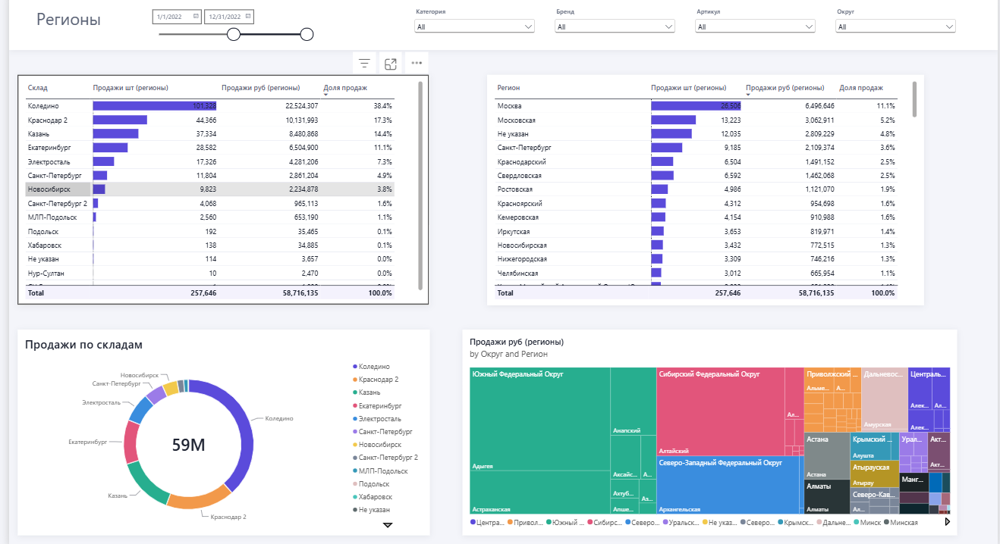

# Wildberries Sales Report (Power BI)

A 4-page report for a marketplace seller on Wildberries, covering January–September 2022. The task was to connect to a database and rebuild a reference report using a given dictionary of business metrics.

**Tools:** Power BI Desktop, DAX, Power Query, PostgreSQL

## Data model

- **Fact tables:** WB Orders, WB Sales, WB Realization Report, WB Stock (loaded from a PostgreSQL database)
- **Dimensions:** Calendar, Products
- **Measures:** stored in a separate `_Measures` table and grouped into display folders: Orders, Sales, Percentages, WB Expenses, Regions

## Report pages

### 1. Main
Key metrics for the period with filters by date, category, brand and article:
- Revenue 58M RUB, order amount 64M RUB, payout to seller 50M RUB
- 281K orders, 255K buyouts, **buyout rate 90.86%**, return rate 1.78%
- WB expenses 21M RUB, average check 228 RUB
- Monthly charts: orders vs revenue, WB expenses broken down into commission, logistics and fines

### 2. SKU details
Revenue by article plus a monthly table with orders, sales, returns, buyouts, logistics and WB commission. Share metrics: sales from orders 92.12%, commission 13.67%.

### 3. Heatmap
Orders by day of the week and hour. Order volume grows from 07:00, stays at its peak between roughly 10:00 and 19:00 (the maximum is at 14:00–15:00) and is evenly spread across weekdays.

### 4. Regions
Sales by warehouse, region and federal district. Koledino warehouse accounts for 38% of sales; Moscow is the top region with 11% of sales.

## Files

- `WB_EA_Report.pbix`: the Power BI report
- `images/`: screenshots of the report pages
